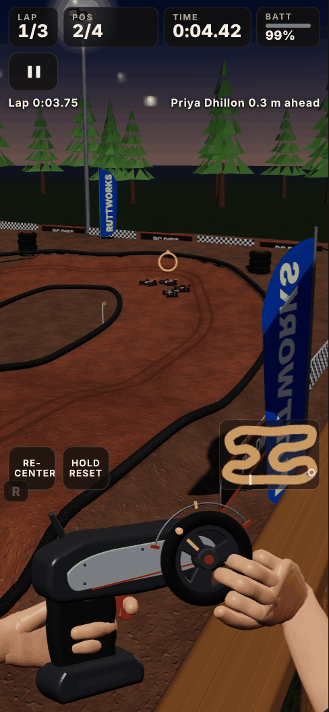
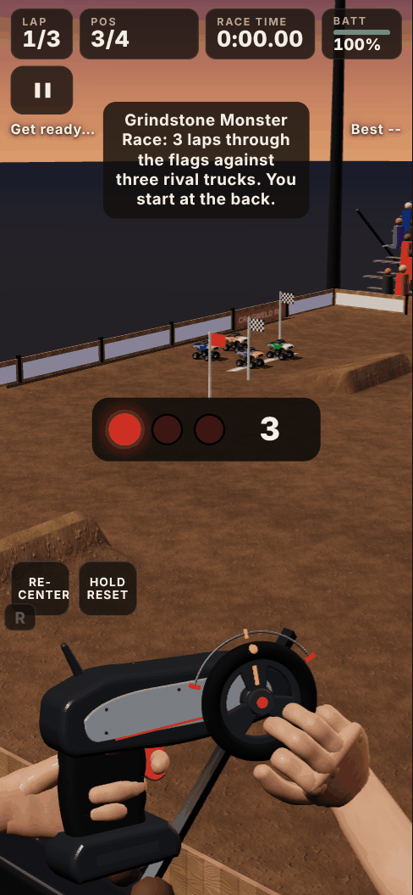
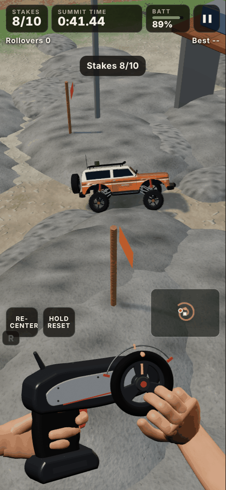
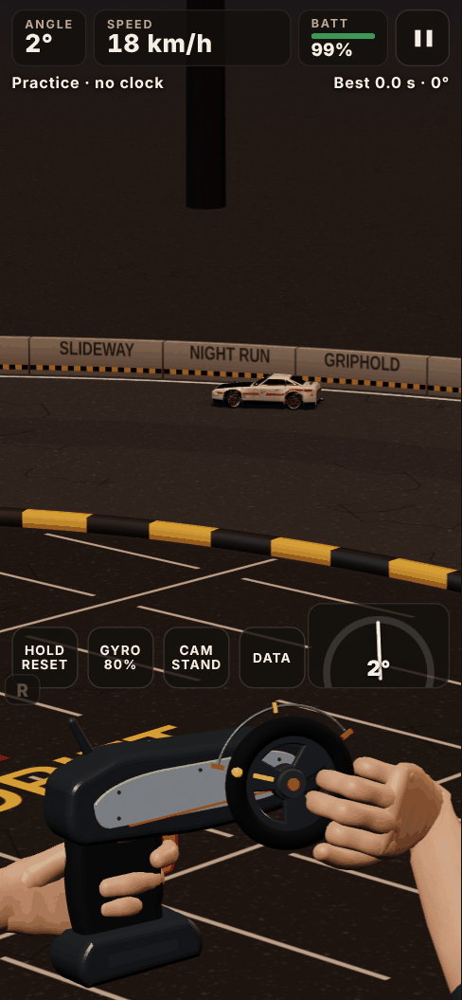
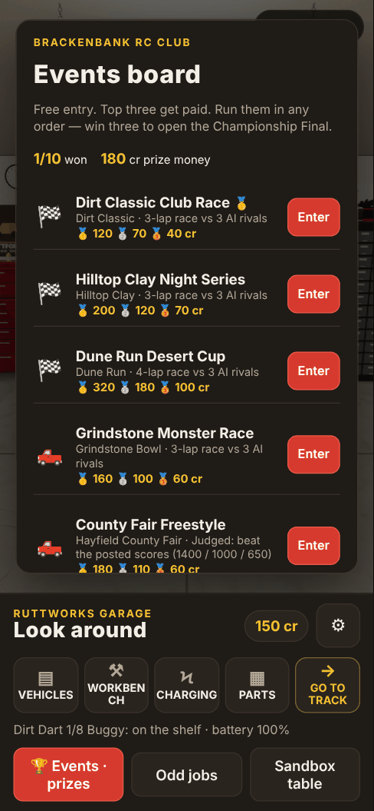

# RC Dirt Garage

A mobile-first RC hobby simulator that runs in the browser. Prep your cars in a 3D garage, drive them from the driver's stand with a hand-held pistol-grip transmitter, wear them out, fix them at the pit table, and race for prize money on the events board.

Built with TypeScript, [Three.js](https://threejs.org/) and [Vite](https://vitejs.dev/). Everything (models, textures, tracks) is generated in code; there are no art files.

<p>
  
  
  
  
</p>

## What's in it

**The garage.** Look around the room, pick a car off the fleet shelves, put it on the workbench, swap and charge batteries, buy parts and hop-ups, paint it, and adjust the setup sheet (shocks, tyres, gearing, diffs).

**Buggies.** Five classes: Dirt Dart 1/8 buggy, Kestrel 2WD, Thumper ST stadium truck, Dunewolf SC10 short course and Brute T8 truggy. Practice or run 3-lap time trials on three tracks: Dirt Classic, Hilltop Clay (night) and Dune Run (desert). There's also a proving loop with telemetry. Driving wears tyres, shocks and chassis, and drains the battery; you repair and tune at the pit.

**Rock crawler.** Two bodies (the '76 Ranchero wagon and the Griphold UTB) and a full upgrade path. Venues: the Mossknuckle Ridge trail, a test yard, The Rock Pile (race to the summit) and the Granite Gulch comp course (gates, scored on points).

**Monster truck.** The Mudhammer, with hop-ups (power, shocks, tyres, flywheel, steering, wheelie bar). Freestyle tricks or gate races at the Grindstone Bowl and the Hayfield County Fair.

**Drift car.** The Slideway RD-1, with an adjustable steering gyro, drift hop-ups and liveries. Drift at Kanjo Hall (indoor) or Bayside Car Park (night).

**Events board.** Ten events across all four vehicles, free entry, prize money for the top three. Buggy and monster events are races against three AI rival cars on the track; crawler, freestyle and drift events are scored against the rivals' posted results. Win three to open the Championship Final.

**Odd jobs.** Mow the neighbour's lawn with an RC mower, or sort the screw tray, for extra credits.



## Controls

The hands at the bottom of the screen hold the transmitter.

- **Steer:** put your right thumb on the wheel and turn it (clockwise = right). Let go and it springs back to centre.
- **Throttle:** drag the trigger **down** to go, **up** to brake. Keep pushing up at a standstill to reverse.
- **Hold RESET** to recover a stuck or flipped car.
- **Keyboard:** WASD or arrow keys, `R` reset, `Esc` pause.

Settings (gear icon) has steering sensitivity, a slide-sideways steering option, transmitter size and reduced motion. Progress saves automatically in the browser (localStorage).

## Run it locally

Needs [Node.js](https://nodejs.org/) 18 or newer.

```bash
npm install
npm run dev        # dev server; --host is on, so you can open it on your phone over Wi-Fi
npm run build      # type-check, then build a single self-contained file: dist/index.html
npm run preview    # serve the production build
```

`dist/index.html` has everything inlined, so you can also just open it from disk or host it anywhere as one file.

## Publish it with GitHub Pages

The workflow in `.github/workflows/deploy.yml` builds the game and publishes it on every push to `main`. Turn it on once: **Settings → Pages → Source: GitHub Actions**. The game will then be at `https://<your-username>.github.io/<repo-name>/`.

## Code map

| Folder | What's there |
|---|---|
| `src/main.ts` | App shell: renderer, screen switching, loading and freeing venue worlds, adaptive resolution |
| `src/data/` | `specs.ts`: all tuning numbers (vehicle classes, tyres, shocks, wear, battery, economy). `events.ts`: the events board, rivals and prizes |
| `src/sim/` | Physics and venue geometry. `VehicleSimulation` (buggies), `CrawlerSim` (crawler and monster truck), `DriftSim`; `Track`, `CrawlTerrain`, `ArenaTerrain`, `DriftTrack`; upgrade catalogues; `AIRacer` and `MonsterAI` (rival drivers) |
| `src/core/` | `InputController` and `gestures` (touch + keyboard), `SessionManager` (laps, checkpoints, penalties), `ServiceSystem` (wear, repairs, setup → handling), `SaveStore` (versioned save with recovery), `state` (save data shape) |
| `src/scenes/` | One scene per screen: `GarageScene`, `PitScene`, `TrackScene`, `CrawlScene`, `MonsterScene`, `DriftScene`, `MowScene`, each with a matching `*World` that builds the 3D venue |
| `src/assets/` | Procedural models and props: buggies, crawlers, monster truck, drift car, mower, transmitter and hands, garage room, venue decor, textures and materials |
| `src/ui/` | Transmitter overlay, parts sheet, telemetry panel, screw-sort mini game, DOM helpers |
| `debug/` | Model viewer pages for the dev server, e.g. `http://localhost:5173/debug/buggies.html` |

Physics runs on a fixed 120 Hz step. `window.__rc` exposes the app for automated checks in the browser console.
